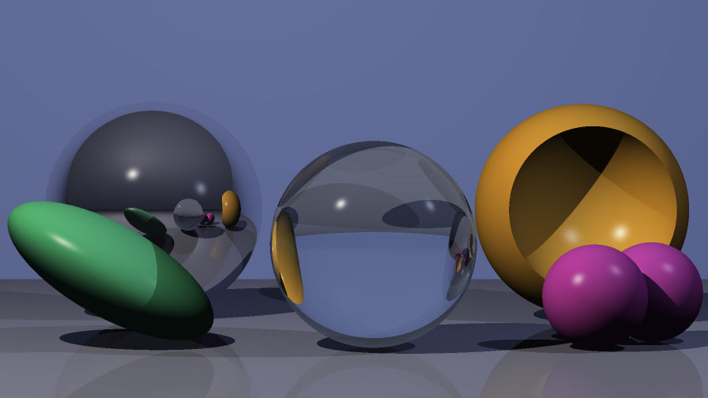
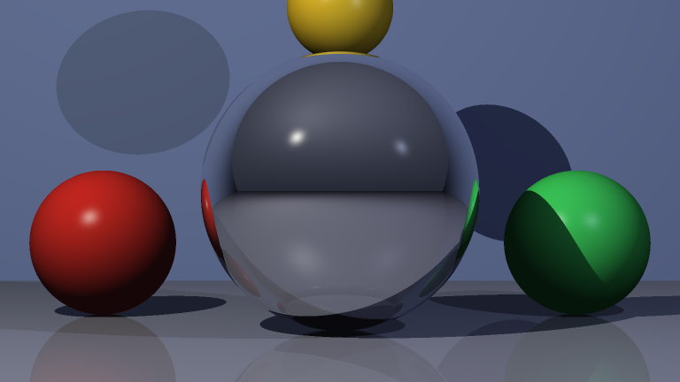
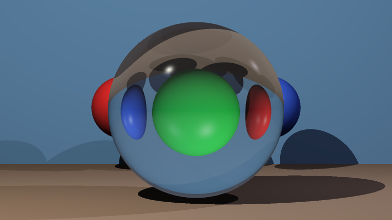
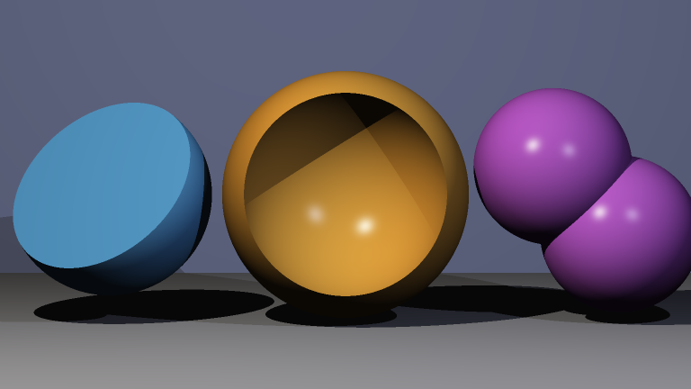

# C++ Raytracer

A from-scratch, multithreaded raytracer for JSON-defined 3D scenes, written in
C++17 as a four-person Object-Oriented Programming project at Hamburg University
of Technology (TUHH).

The project received **20/20 points, earning 4 bonus points**. See the
[original evaluation](eval.md).



## Highlights

- Whitted-style recursive raytracing with Phong illumination, hard shadows,
  reflection, and refraction
- Constructive solid geometry (CSG): union, intersection, and difference
- Affine transformations using homogeneous coordinates and inverse-transpose
  normal transformation
- 2x2 supersampling for antialiasing and row-based rendering across CPU cores
- Validated JSON scene format with recursively nested objects
- Clean C++17 object model with RAII and exclusive ownership via
  `std::unique_ptr`
- Automated geometry and parser tests with CTest
- Optional Python bindings through pybind11 and generated API documentation
  through Doxygen

The renderer uses Eigen for linear algebra, nlohmann/json for scene input, and
OpenCV only to encode the finished pixel buffer. The raytracing, intersection,
shading, transformation, and CSG logic are implemented in this repository.

## How it works

```text
JSON scene -> validated object tree -> camera rays -> closest intersections
           -> Phong shading + shadow rays -> recursive reflection/refraction
           -> supersampled RGB buffer -> PNG
```

The scene owns a polymorphic tree of primitives, transformations, and CSG
nodes. Rays are transformed into object space for intersection tests; surface
normals are transformed back with the inverse transpose. Each primary ray is
then shaded and, where required, recursively reflected or refracted.

For the detailed object model and transformation math, see the
[design document](docs/design.md). The complete scene schema is documented in
the [JSON input format](docs/inputFormat.md).

## Gallery

| Reflection | Refraction | CSG operations |
| :---: | :---: | :---: |
|  |  |  |

Six reproducible showcase scenes are included with their JSON source and
reference renders. See the [showcase guide](examples/showcase/README.md) for
what each image demonstrates.

## Quick start

After installing the dependencies listed below, run these commands from the
repository root:

```bash
cmake -S . -B build -DCMAKE_BUILD_TYPE=Release
cmake --build build
ctest --test-dir build --output-on-failure
./build/raytracer examples/showcase/03-phong-schatten.json out.png
```

The command produces `out.png`, and the test run should report that all tests
passed.

## Dependencies

Required:

- a C++17-compatible compiler
- CMake 3.16 or newer
- Eigen
- nlohmann/json
- OpenCV (PNG output)

Optional:

- Doxygen and Graphviz for generated API documentation
- Python 3 and pybind11 for the Python extension module

On macOS with Homebrew:

```bash
brew install cmake eigen nlohmann-json opencv doxygen graphviz pybind11
```

On Debian or Ubuntu:

```bash
sudo apt install build-essential cmake libeigen3-dev nlohmann-json3-dev \
    libopencv-dev doxygen graphviz python3-dev pybind11-dev
```

If Homebrew dependencies are not discovered automatically, configure with:

```bash
cmake -S . -B build -DCMAKE_BUILD_TYPE=Release \
    -DCMAKE_PREFIX_PATH="$(brew --prefix)"
```

The build enables `-Wall`, `-Wextra`, and `-Wpedantic` with Clang and GCC. If
pybind11 is unavailable, only the optional Python module is skipped.

## Usage

The command-line application accepts a scene file and an output path:

```bash
./build/raytracer <scene.json> <output.png>
```

Included scenes:

| Scene | Demonstrates |
| --- | --- |
| `01-reflection.json` | mirror reflection |
| `02-refraction.json` | refraction through transparent objects |
| `03-phong-schatten.json` | Phong shading and hard shadows |
| `04-csg.json` | CSG union, intersection, and difference |
| `05-transformationen.json` | translation, scaling, and rotation |
| `06-showcase.json` | all features combined |

Render all showcase scenes with the C++ application:

```bash
mkdir -p out
for scene in examples/showcase/*.json; do
    ./build/raytracer "$scene" "out/$(basename "$scene" .json).png"
done
```

Rendering uses the available CPU cores. Reflection-heavy and refraction-heavy
scenes take longer because each hit can spawn secondary rays.

## Tests and documentation

Run the automated tests with:

```bash
ctest --test-dir build --output-on-failure
```

The test suite covers successful and invalid scene parsing, homogeneous
coordinates, material defaults, normalized normals, recursively nested
transformations and object combinations, ray evaluation, primitive
intersections, transformed normals, CSG operations, and color combination.
Test expectations remain active in both Debug and Release builds.

The repository also includes continuous integration for clean Linux builds and
test runs on every push and pull request.

To generate the Doxygen API documentation:

```bash
cmake --build build --target docs
```

The generated entry page is `build/docs/html/index.html`.

## Optional Python interface

When pybind11 is installed, CMake builds `raytracer_py` alongside the C++
application. It exposes the same pipeline as one function:

```python
import raytracer_py

raytracer_py.renderScene("examples/basicScene.json", "out.png")
```

The included batch script can render all or selected showcase scenes:

```bash
python3 render_showcase.py
python3 render_showcase.py 04-csg
```

## Project structure

```text
.
├── CMakeLists.txt       Build, test, documentation, and Python targets
├── include/
│   ├── geometry/        Primitives, transformations, CSG, rays, and hits
│   ├── io/              Scene parser and image writer interfaces
│   ├── render/          Renderer interface
│   └── scene/           Screen, medium, lights, and scene model
├── src/                 C++ implementations and command-line entry point
├── tests/               Geometry and scene-parser tests
├── examples/            JSON scenes and reference renders
└── docs/                Design, input-format, and project documentation
```

## Team and attribution

Developed collaboratively by:

- Kevin Fister
- Lea Fricke
- Merle Mai
- Annika Neubauer
