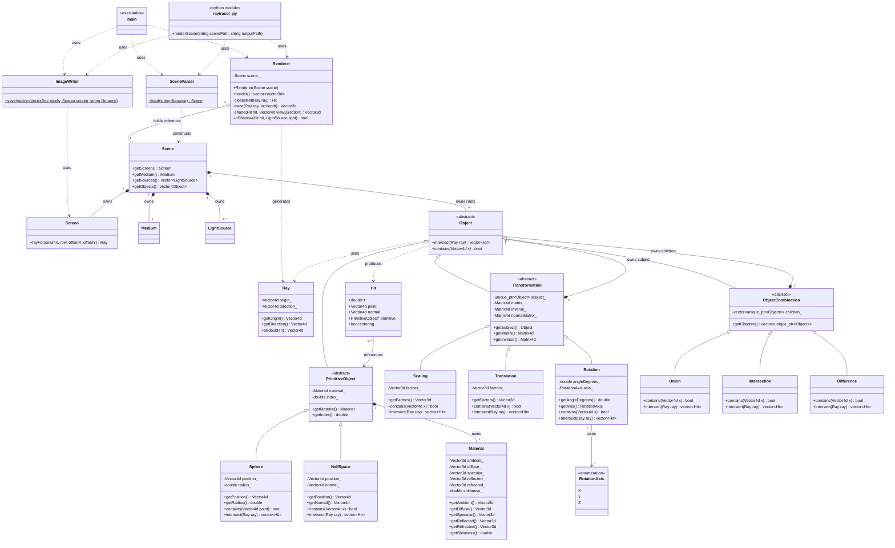

# Design

## Status

The raytracer is feature-complete for the core pipeline:

1. open the input file and parse JSON
2. construct the screen, observer, medium, and light sources
3. recursively construct the geometric object tree (primitives,
   transformations, CSG combinations)
4. validate the documented input constraints
5. cast primary rays per pixel (with antialiasing supersampling), find the
   closest intersection, and recursively trace reflection/refraction rays
   (Whitted-style)
6. shade intersections with Phong illumination and shadow rays
7. write the resulting pixel buffer to a PNG file (or hand it back through
   the optional Python bindings)

## Architecture

```text
JSON scene file
    │
    ▼
SceneParser  ── parsing, defaults, validation, normalization
    │
    ▼
Scene        ── owns screen, medium, lights, and object-tree roots
    │
    ▼
Renderer     ── casts rays, resolves intersections, shades, recurses
    │
    ▼
ImageWriter  ── converts the pixel buffer to PNG (OpenCV)
    │
    ▼
Image file (or, via pybind11, back to a Python caller)
```

`SceneParser` is the boundary between external input and the raytracer's data
model. `SceneParser::load()` either returns a complete, valid `Scene` or throws
`std::runtime_error`. `Renderer` and `ImageWriter` work exclusively with the
internal `Scene`/`Hit`/`Ray` model and never touch JSON.

## Responsibilities

### SceneParser

- reads JSON using nlohmann/json
- checks required fields and their JSON types
- converts JSON arrays to Eigen vectors
- converts points and directions to homogeneous coordinates
- applies default material coefficients
- validates numeric constraints
- normalizes half-space normals
- recursively constructs object trees

### Scene

A `Scene` owns:

- one `Screen`
- one `Medium`
- zero or more `LightSource` values
- zero or more root `Object` instances

### Geometry model

`Object` is an abstract base class with two pure virtual operations:

- `intersect(const Ray&) const -> std::vector<Hit>`
- `contains(const Eigen::Vector4d&) const -> bool`

Every concrete object in the tree — primitives, transformations, and CSG
combinations — implements both in terms of its own geometry and, where
applicable, by delegating to its children/subject.

### Renderer

`Renderer` owns no state beyond a reference to the `Scene`. For each output
pixel it:

- casts one or more sub-pixel-offset camera rays (`Screen::rayFor`) and
  averages the results (antialiasing)
- finds the closest `Hit` via `closestHit()`, which intersects the ray with
  every root object and keeps the smallest positive `t`
- shades the hit point with `shade()` (ambient + diffuse + specular Phong
  terms, using `inShadow()` shadow rays per light source)
- recursively traces reflection and refraction rays via `trace()` up to a
  fixed recursion depth, blending their contributions into the local shading
  result

### ImageWriter

Converts the `Renderer`'s row-major `std::vector<Eigen::Vector3d>` pixel
buffer into 8-bit BGR and writes it with OpenCV, flipping rows as needed to
match image coordinate conventions.

## Current class diagram



The base classes are not concrete: `PrimitiveObject`, `Transformation`, and
`ObjectCombination` have protected constructors, so callers use their concrete
derived classes.

## Recursive object representation

Primitive objects are leaves. A transformation owns exactly one complete object
as its subject. A combination owns an ordered collection of complete child
objects. Any child may itself be a primitive, transformation, or combination.

For example:

```text
Union
├── Scaling
│   └── Sphere
└── Intersection
    ├── HalfSpace
    └── Difference
        ├── Sphere
        └── Translation
            └── Sphere
```

`SceneParser::parseObject()` builds this representation recursively, and
`Object::intersect()`/`contains()` walk it recursively at render time.

## Ownership and lifetime

Ownership is represented with `std::unique_ptr<Object>`:

- `Scene` exclusively owns each root object
- `Transformation` exclusively owns its subject
- `ObjectCombination` exclusively owns its children
- destroying a `Scene` automatically destroys the complete object tree
- no code should manually call `delete` for scene objects

Because it contains `unique_ptr` instances, `Scene` is movable but not copyable.
Its getters return const references so rendering can inspect the scene without
transferring ownership.

## Mathematical representation

Eigen is used throughout for vectors and transformation matrices.

- a point `(x, y, z)` is stored as `(x, y, z, 1)`
- a direction `(x, y, z)` is stored as `(x, y, z, 0)`
- RGB values are stored as three-component vectors

A half-space normal may have any non-zero length in the JSON input. The parser
normalizes it before constructing `HalfSpace`. Downstream geometry and lighting
code can therefore rely on normals from parsed half-spaces having unit length
and a homogeneous `w` component of zero.

### Transformations (B.10: matrix-based)

`Transformation` is the shared base class for `Translation`, `Scaling`, and
`Rotation`. Each derived class only builds a 4x4 homogeneous matrix describing
its effect (a translation matrix, a diagonal scaling matrix, or an
axis-aligned rotation matrix) and passes it to the `Transformation`
constructor, which additionally computes and stores:

- `matrix_` — the forward matrix (local space → world space)
- `inverse_` — `matrix_.inverse()` (world space → local space)
- `normalMatrix_` — `inverse_.transpose()`, used to correct normals so that
  non-uniform scaling and other non-orthogonal transformations still produce
  correct surface normals

`Transformation::intersect()` and `Transformation::contains()` are implemented
once, generically, in the base class:

- a world-space ray/point is mapped into the subject's local space with
  `inverse_`
- the subject computes intersections/containment entirely in its own local
  space, unaware that it is nested inside a transformation
- resulting hit points are mapped back to world space with `matrix_`; hit
  normals are mapped back with `normalMatrix_`, re-zeroing the homogeneous `w`
  component and renormalizing

Because points have `w = 1` and directions have `w = 0`, multiplying a ray's
direction by a matrix that includes a translation component correctly leaves
the direction unaffected — no special-casing is needed between translation,
scaling, and rotation.

## Materials and refractive indices

Every primitive owns one `Material` and one refractive index. A material stores:

- ambient, diffuse, and specular RGB coefficients
- reflected and refracted RGB coefficients
- shininess

Transformations and combinations do not have separate materials or refractive
indices. An intersection uses the values belonging to the primitive reached at
that point in the object tree (available via `Hit::primitive`).

## Validation guarantees

For scenes returned by `SceneParser::load()`:

- all required top-level entries exist and have the expected JSON type
- vector sizes and component types are valid
- DPI, dimensions, radii, and refractive indices are positive
- recursion depth and shininess are non-negative
- RGB coefficients are in `[0, 1]`
- scaling factors are non-zero
- half-space normals are non-zero and normalized
- rotation directions are supported
- every object has exactly one recognized object-type key
- every transformation has a valid subject
- every combination contains an array of recursively valid objects

These guarantees apply to objects created by the parser. The model constructors
currently do not repeat all parser validation when called directly.

## Error behavior

Invalid input produces `std::runtime_error` with a field-oriented message.
Examples include:

- `screen.dpi must be greater than zero.`
- `sphere.radius must be numeric.`
- `scaling.subject is required.`
- `Unsupported object type: ...`

The caller should catch errors at the application boundary and present the
message to the user. Rendering code should not try to repair an invalid scene.

## Python bindings

`src/python/bindings.cpp` exposes a single pybind11 function,
`raytracer_py.renderScene(scenePath, outputPath)`, which internally performs
the same three steps as `main.cpp` (`SceneParser::load` →
`Renderer::render` → `ImageWriter::save`). The target is built only if
pybind11 is found by CMake (`find_package(pybind11 CONFIG QUIET)`), so it is
optional and does not affect the plain C++ build. `render_showcase.py` uses it
to batch-render the example scenes.

## Development stages

- [x] Define scene data model and parser interface
- [x] Parse screen and medium information
- [x] Parse light sources
- [x] Parse primitive objects
- [x] Parse transformations recursively
- [x] Parse object combinations recursively
- [x] Complete semantic validation
- [x] Add ray/object intersection behavior and integrate the renderer
- [x] Phong shading, shadows, recursive reflection/refraction
- [x] Antialiasing (supersampling)
- [x] Matrix-based transformations (B.10)
- [x] Optional Python bindings
- [x] Full UML class diagram (see "Current class diagram" above)
- [x] Written project report
